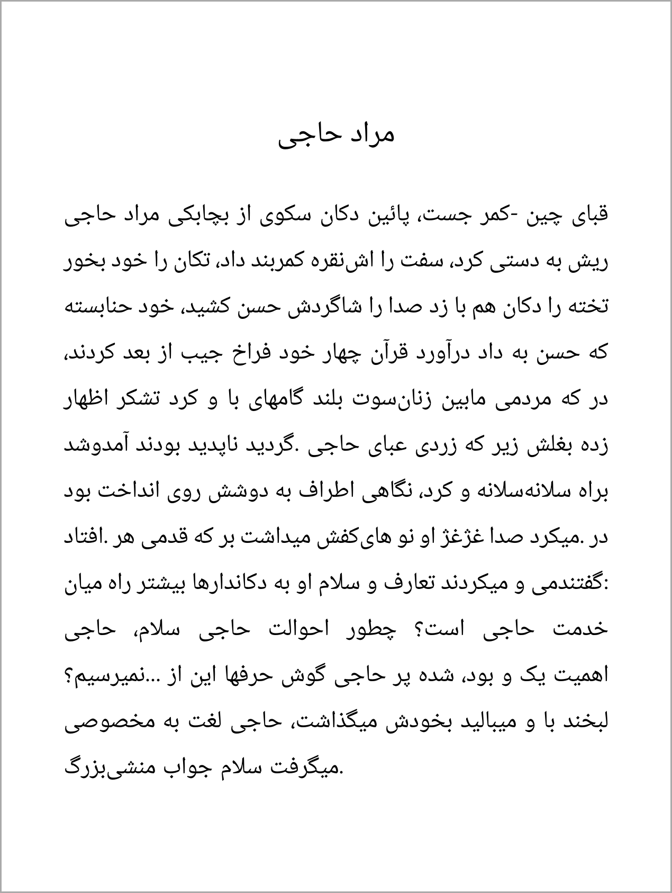
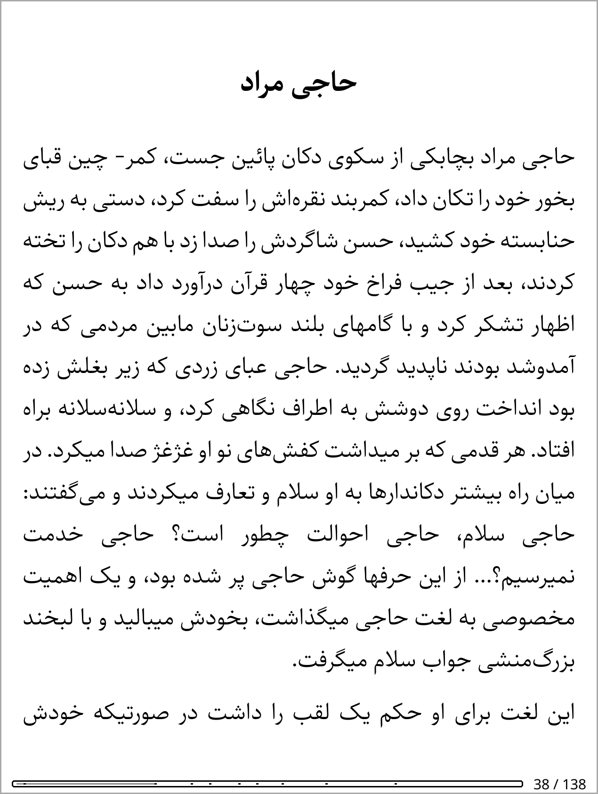
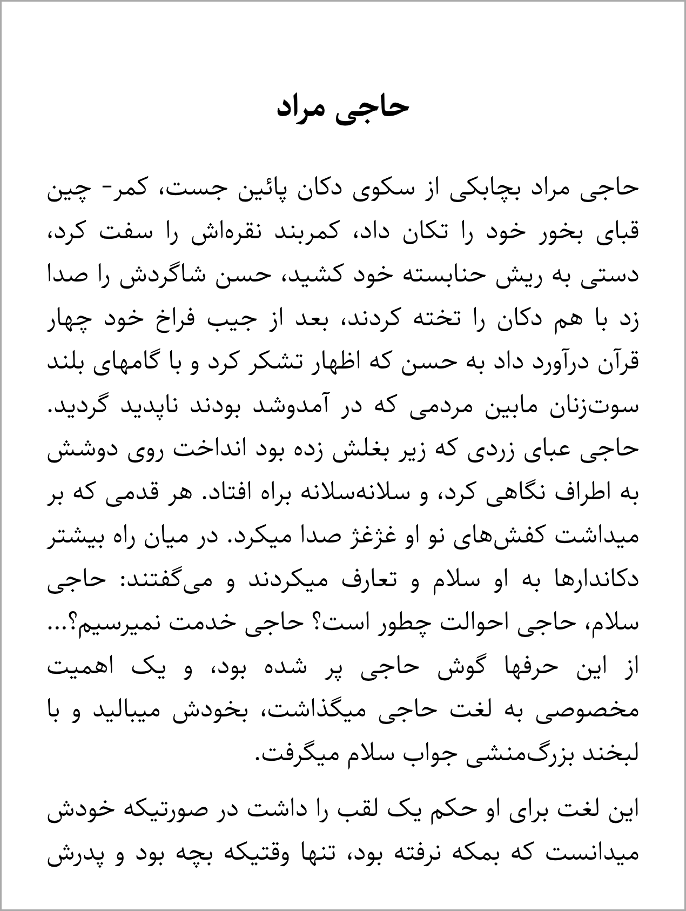
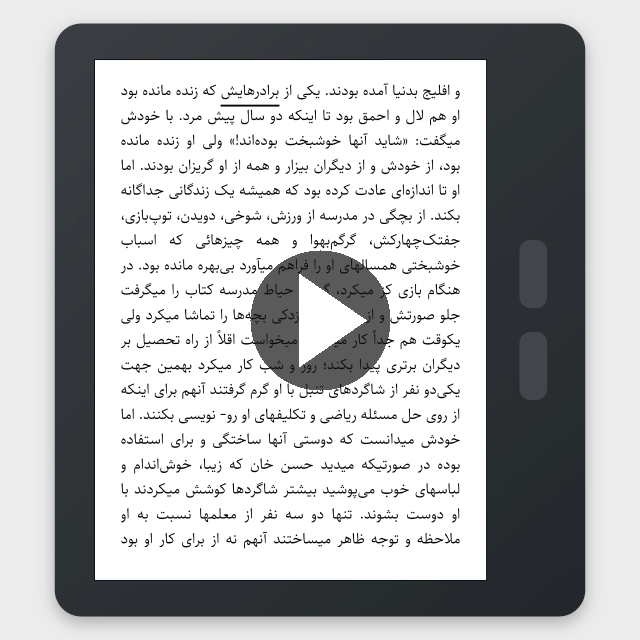

<p align="center">
  
  
</p>

<p align="center">
  A light EPUB reader for e-ink, built on open source tools such as
  <a href="https://github.com/DioxusLabs/blitz">Blitz</a> and <a href="https://github.com/readium/go-toolkit">Readium</a>.<br>
  Right-to-left books done properly, Farsi first.
</p>

<p align="center">
  <a href="https://github.com/ardeshirj/shamsaink/actions/workflows/ci.yml"></a>
  <a href="LICENSE"></a>
</p>

## Install
On a Kobo with [NickelMenu](https://pgaskin.net/NickelMenu/), plugged into a Mac or Linux computer over USB with Connect
tapped:

```sh
curl -fsSL https://raw.githubusercontent.com/ardeshirj/shamsaink/main/install.sh | sh
```

It downloads the newest [release](https://github.com/ardeshirj/shamsaink/releases), checks it and copies it onto the Kobo,
which installs it and restarts. Then NickelMenu → ShamsaInk. Installing by hand and removing it:
[`docs/devices/kobo/install.md`](docs/devices/kobo/install.md); building it yourself:
[`docs/devices/kobo/setup.md`](docs/devices/kobo/setup.md).

**Not for everyone yet:** until the beta the releases are pre-releases, tried on a **Kobo Libra Colour** (firmware
4.46) only, and the reader stops Kobo's own interface while a book is open. A guide for readers comes with the beta
([`ROADMAP.md`](ROADMAP.md)).

## Why it exists
An e-ink device is made for reading: easy on the eyes, free of distraction, with a charge that lasts. Farsi, though, is
overlooked on these devices: Plato sets its paragraphs reversed, and KOReader breaks its lines differently from a
browser and has declined narrated books.

ShamsaInk is the reader built for it. It sets right-to-left books the way a browser sets them, and reads a narrated book
along with you², underlining each word as it is spoken. Blitz, a CSS engine written in Rust, draws the pages, so books and
the reader's own panels are ordinary HTML and CSS, and each device sits behind one small interface, which makes it easy
to adapt to new devices. Here is the same page of *Buried Alive*, chapter 2, in all three:

<table>
<tr>
<th width="33%"><a href="https://github.com/baskerville/plato">Plato</a></th>
<th width="33%"><a href="https://github.com/koreader/koreader">KOReader</a></th>
<th width="33%">

ShamsaInk
</th>
</tr>
<tr>
<td valign="top"></td>
<td valign="top"></td>
<td valign="top"></td>
</tr>
<tr><th colspan="3" align="left">Right to left</th></tr>
<tr>
<td align="center">❌</td>
<td align="center">✅</td>
<td align="center">✅</td>
</tr>
<tr><th colspan="3" align="left">Lines broken where a browser breaks them¹</th></tr>
<tr>
<td align="center">not measured</td>
<td align="center">42–67%</td>
<td align="center">88–99%</td>
</tr>
<tr><th colspan="3" align="left">🎧 Reads along: each narrated word underlined as it is spoken</th></tr>
<tr>
<td align="center">❌</td>
<td align="center">❌ (<a href="https://github.com/koreader/koreader/issues/9548">declined</a>)</td>
<td align="center">✅²</td>
</tr>
</table>

<sub>¹ Line starts that match Chromium's, on four of rtlbook's Farsi books.<br>
² Kindle: the underlining works, but sound is unofficial and unreliable. Kobo is the first target.</sub>

Narration can change how a book is read: a classic made easier to follow, a language learned by ear and eye together.
We want Farsi and other right-to-left books done properly, and books that read along.

<p align="center">
  <a href="https://youtu.be/jwZjB0vJuRs"></a><br>
  <sub><b>Read-along, with sound</b> (YouTube; emulated in the browser, the same pages and timings as on the Kobo)</sub>
</p>

It is part of FarsiEPUB, which converts Farsi PDFs to EPUB and keeps a library of public-domain Farsi classics. Those
books are what it was made to read well, but it opens any EPUB.

## Why build on existing tools
Why rewrite what modern open source already does well? We tried, and measured:

- **A browser's CSS is years of work.** Our own layout matched a browser on four Farsi books, but only for
  the CSS those books use: on a real English book it got 89 pages right where [Blitz](https://github.com/DioxusLabs/blitz)
  got 383 of 388. Blitz is a modern CSS engine in Rust built on Firefox's style engine, with Parley for text. So Blitz
  draws the pages, and we add the pagination, a glyph layer and a cache that make it as fast as KOReader's engine on
  these devices.
- **EPUB is a large standard.** [Readium's Go toolkit](https://github.com/readium/go-toolkit) reads it for us: the chapters in
  reading order, the table of contents, reading positions and the narration timings that tell us which word is being
  spoken. It is an established open source toolkit, and it runs on these devices as it is.
- **Farsi shaping and line breaking come with Blitz.** Right-to-left text, joined letters and a browser's line breaks are
  the hard part, and a browser engine already does them: on Farsi books Blitz's line starts match Chromium's in 88–99% of lines.
- **Modern and self-contained.** Rust and Go, with Blitz drawing the pages from ordinary HTML and CSS: one static
  binary for all the devices, with nothing to install around it.

What is our own is the screen (refresh, touch, sleep, sound) and the reader on top: the panels, the settings, the
library and the read-along. [`docs/DESIGN.md`](docs/DESIGN.md) has how the parts fit and what each one depends on.

## What it does
- **Reads right-to-left text properly.** Farsi shaping and direction come out right, with no `dir` attributes needed in
  the book. It uses real CSS (flex, grid, custom properties), so books with their own styling look as designed.
- **Is quick.** As fast as KOReader's engine (crengine) on these devices, and a cache file per book so a reopened
  book comes up quickly.
- **Reads along (experimental).** For books with narration (EPUB media overlays), it plays the voice through Bluetooth
  headphones and marks each word as it is spoken. It works, but a bug in Kobo's firmware gives it one cost: once
  Bluetooth has been used since the Kobo started, Kobo's own interface cannot be started a second time without a
  kernel crash ([koreader/koreader#12739](https://github.com/koreader/koreader/issues/12739), which KOReader and Plato
  have too). So when you leave ShamsaInk after using Bluetooth, the Kobo **restarts** instead of returning to its home
  screen (a minute; your place, highlights and settings are saved first). Reading without Bluetooth is not affected.
  The headphones' own delay is a setting we have not built yet.
- **Is made for the screen.** Page turns without flashes, partial refreshes for panels and menus, a dark mode, the
  front light and its warmth, touch and the Kobo's page buttons, contents, highlights, sleep and wake, and a sleep
  screen from your own pictures. The interface is in English or Farsi.

## Where things are
| | |
|---|---|
| [`reader/`](reader/) | The reader: Go, the screen, touch, sleep, sound and the panels (HTML templates drawn by Blitz) |
| [`engine/`](engine/) | The page engine: Rust, Blitz with our layout, glyph drawing and the cache |
| [`bench/`](bench/) | One interface over the engines, to compare them on the same books |
| [`docs/`](docs/) | [Design](docs/DESIGN.md), the [design system](docs/DESIGN-SYSTEM.md), the devices ([Kobo](docs/devices/kobo/README.md), [Kindle](docs/devices/kindle/README.md)) and the [working plan](docs/PLAN.md) |
| [`e2e/`](e2e/) | End-to-end scenarios run on a device |

## About the name
A *shamsa* (شمسه, "little sun") is the illuminated sunburst medallion on the opening page of a Persian manuscript,
the first thing a reader saw on opening a book. *Ink* is the illuminator's, and the screen's. The mark is an
eight-pointed star with a saffron dot at its centre.

## License
The code is under the [Apache License 2.0](LICENSE); credits for what it builds on are in [NOTICE](NOTICE). The names
ShamsaInk and FarsiEPUB and their logos are not part of the license: all rights reserved. ShamsaInk is by FarsiEPUB. Please
don't use the names or logos for your own product or fork. [BRAND.md](BRAND.md) says how they may be used.
