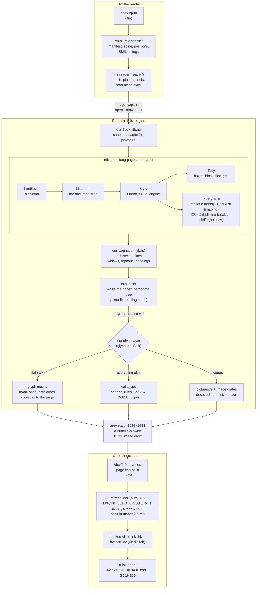
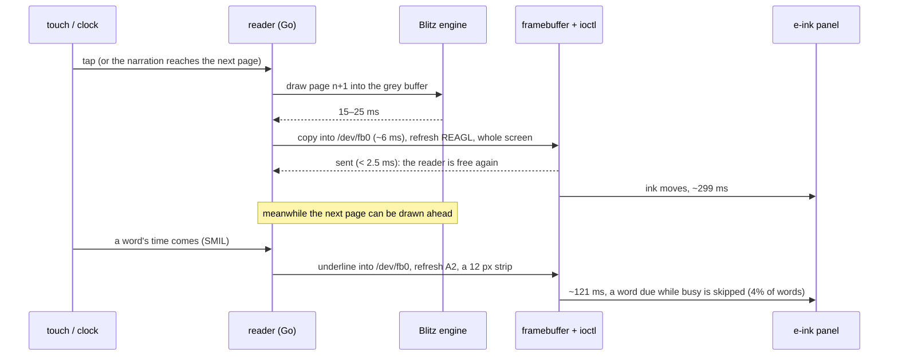
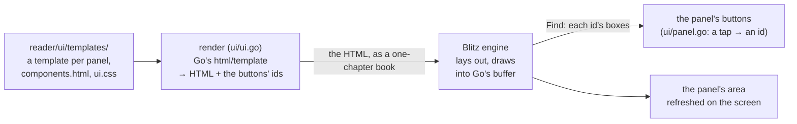
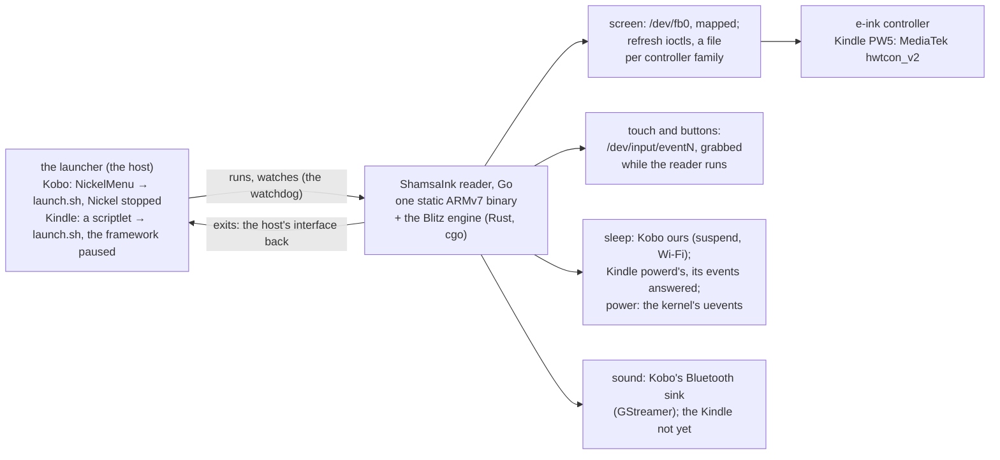
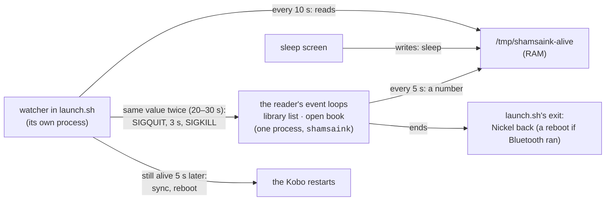

# ShamsaInk's design: the parts, from the book to the ink (2026-10-25; the reader 2026-10-29)

What each part is, how a page goes from an EPUB file to ink on the screen, how the reader's panels are drawn, what
the reader stands on on a device, where we stand against crengine, and what it all depends on. The work ahead, in order of priority, is in `PLAN.md`; the details and every
measurement in the experiments' NOTES.md files (the numbers here: 08 on the reMarkable 2, 09–10 on the Kindle).

## 1. The layers

- **Go runs the reader:** readium/go-toolkit reads the book (zip, manifest, spine, table of contents, positions, the
  media overlays' timings); Go owns the screen (the framebuffer and its refreshes), touch, the reader's state.
- **The layout engine sits behind one narrow interface,** so it can be swapped and judged: Blitz (Rust, through cgo)
  is the one we use; our Go engine on go-text (03) is the reference for rtlbook's books; crengine (02, KOReader's) is
  the bar to measure against, never shipped (GPL-2.0).
- **The engine draws into a buffer Go owns,** a byte of grey a pixel, so a page is not copied across the boundary.

**The interface keeps state; it is not one call per page.** Page 40 depends on everything laid out before it,
read-along asks which page and boxes hold a word's id, Readium positions ask the reverse, and a tap asks what is under
a finger. So a book is opened once and kept behind a handle:

```
open(book source, page size, settings)    lay out (the chapter shown first, the rest after), or restore from cache
page count
draw page n into a buffer Go owns
page and boxes of an element id           read-along
id at a point                             taps, selection (not built yet)
```

In Go: `bench/` (`engine.Document`: `Pages`, `Draw`, `Find`, `Close`; engines by name: "gotext", "cre"
with `-tags cre`, "blitz" with `-tags blitz`, an adapter over the binding in `engine/go`, module `shamsainkengine`). Across cgo (`engine/src/capi.rs`, `engine/blitz_engine.h`) Go passes
its buffers in, strings as pointer and length, and answers the engine's file requests through a callback, so
go-toolkit stays in charge of the EPUB. 08's chapter-first opening and the cache go through it too (`Save`, `Restore`
in `engine/go`, used by `reader/book.go`).

## 2. From the book to the ink

Every part a page goes through, whose it is, and its time on the Kindle (two Cortex-A53 cores, *Buried Alive* and
Holmes).



| Step | Part | Whose | Notes |
|---|---|---|---|
| Read the book | readium/go-toolkit | Readium, BSD | trimmed of its cloud SDKs (02's `trim-gotoolkit.sh`) |
| Parse | html5ever, blitz-html, blitz-dom | Servo's parser; Blitz | XHTML into a tree |
| Style | Stylo | Firefox's CSS engine (MPL-2.0) | the books' real CSS; why Blitz matches Chromium on 383 of 388 pages (05) |
| Boxes | Taffy | Dioxus Labs | block, flex, grid; not text |
| Text | Parley, with fontique, HarfRust, skrifa, ICU4X | Linebender; HarfRust: HarfBuzz's; ICU4X: Unicode | fonts, shaping (Farsi joined right), bidi, line breaking; Blitz's text layouts on both cores (`parallel-construct`) |
| Pages | `lib.rs` | ours | Blitz has no pagination: we cut its long page between line boxes, 03's rules |
| Keep | `saved.rs` | ours | a cache file per book (pages, glyph masks): a reopen lays out only the chapter shown |
| Paint | blitz-paint, anyrender | Blitz | a scene of drawing commands for the page; our patch skips lines off the page |
| Glyphs | `glyphs.rs` | ours | each glyph drawn once into a mask (by vello_cpu), then copied: 266 → 20 ms a page (07) |
| The rest | vello_cpu | Linebender | shapes and SVG; runs only on pages that have any |
| Pictures | `pictures.rs`, image, zune-jpeg, png | ours; image-rs | only their size read for layout (our Blitz patch); decoded when drawn, at that size |
| Screen | `/dev/fb0` mapped; one ioctl a refresh | ours, Go (10) | a file per controller family; Kindle MediaTek done |
| Ink | the kernel's driver and the panel | Amazon, E Ink | the waveform decides time and look |

### A page turn and a narrated word, in time



The narration reaches the next page when a narrated element's first line is on it, or, for a sentence or paragraph
that runs onto it (narration by sentence or paragraph, as IDPF's Moby-Dick), when the voice reaches the element's first
line there (2026-11-08): the engine gives every line of the element with its page (`find_lines_all`), and the moment is
the element's share of its time as its lines' share of its width (`underline`, `pageTurn` in `reader/narration.go`).
Until then the page turned with the next element only, its end spoken over the old page.

### The reader's panels

The menu, the contents, the navigation panel, the highlight's panel and the clock's digits are HTML too, drawn by the
same engine as the book: **Go writes the HTML, Rust only draws it.** Nothing in the engine knows a menu or a button.



- **Components:** `components.html` defines the pieces (`button`, `choice`, `toggle`, `segments`, `stepper`, `switch`)
  as Go template blocks; each panel's template uses them. The functions that build a component's value (`btn`, `pick`,
  `step`, `list`) record each button's id as they go, so a button drawn is a button that can be tapped, with no list
  kept in Go. The templates are in the binary (`go:embed`), parsed once.
- **Modern CSS** (Blitz is a modern engine): custom properties, flex with `gap`, grid, logical sides. Not all CSS is in
  Blitz, and a page ends at its last line of text (a box's edge below it is cut off; `drawPanel` adds an empty line),
  so panels are checked by drawing them: `TestPanels`, `TestPanelEdges`.
- **A tap redraws the panel:** the settings change in Go, the panel is rendered and laid out again, and only its area
  is refreshed. No state lives in the HTML; on e-ink nothing animates, and a panel is small next to its refresh.
- **The clock** is drawn once as glyphs by the engine (in Parastoo, FarsiEPUB's font) and put together for each
  time: a page turn costs no layout, and its own box is refreshed once a minute (`ui/clock.go`). It is centred over the
  text, between the edges most of the page's lines share, measured on the page's ink (the book's own margins count;
  0.2 ms a page on the Mac). Drawing it in each book's own font was tried: ~70 ms more a book opened on the Kindle.
- Why not in Rust (askama, Dioxus): the panels' data and logic are Go's; a Rust interface would need them across the C
  API or moved, for no measured cost today. `dioxus-native-dom` was tried (14: identical drawings, 1.3–1.7 ms either
  way, +0.7 MB), so the panels stay Go templates, and their HTML and CSS carry over if the reader ever moves to Rust.
- **Interface language** (built 2026-10-31): **one switch, no list**, "Follow book language", on by default. On: the
  menus and panels are in the book's language when there is a table for it (`ui/words/en.json`, `fa.json`), else
  English; the library is always English (the language is for reading a book; a Farsi title among English ones keeps
  its own direction). Off: English everywhere. Global, never per book: `settings.json`'s `english_only` (absent:
  following, so an old file stays valid). In the library's menu only (≡ › Settings, a small panel in the menu's place,
  the switch at the row's end; a tap applies it at once, everything shown drawn again in the new language and
  direction). Strings are a table per language (`{{t "contents"}}`, whole sentences with `%d`/`%s` slots; a test
  checks the tables have the same keys); Farsi digits; `dir` and `lang` on each panel; pointing icons mirrored
  (`.flip`). To check on the Kobo: the menu font (Parastoo), the Farsi wording, the opening screen at launch.

## 3. The engines

| Engine | What it is | Use |
|---|---|---|
| **Blitz** ("blitz") | Blitz's CSS and layout, our pagination, glyph layer, pictures and cache | the engine (decided 2026-10-25): real CSS, Farsi right, crengine's speed |
| Go engine ("gotext") | our layout on go-text, rtlbook's CSS subset | the reference on rtlbook's books (94–100% of Chromium's line starts) |
| crengine ("cre") | KOReader's engine, C++, its own HTML, CSS, pagination | the bar to measure against; GPL-2.0, never shipped |

Any engine is judged the same way: 03's `compare.sh` (every word in a span, then each engine and Chromium say where it
went), the read-along test (`bench/cmd/readalong`), times and memory on a device.

## 4. On the device

What the reader stands on on an e-ink device. Two devices so far (`devices/README.md`): the Kobo Libra Colour, started
from NickelMenu with Kobo's interface stopped while reading, and the Kindle Paperwhite 11th gen, started from a scriptlet
in its library with Amazon's framework paused (2026-11-06; before, inside KOReader through our plugin, removed 2026-11-07).



| Part | What it does | Whose | State |
|---|---|---|---|
| the launcher | the host: starts the reader on the library, stops (Kobo) or pauses (Kindle) the device's own interface while it runs and brings it back after, logs, the watchdog | ours, shell (`reader/kobo/launch.sh`, `reader/kindle/launch.sh`), started by NickelMenu (Kobo) and a scriptlet (Kindle, the jailbreak's shell integration) | both (the Kindle's since 2026-11-06) |
| screen refresh | the page into the framebuffer, refreshed with a waveform: REAGL page turns, A2 for the read-along mark (10) | ours, Go | the Kindle's MediaTek driver done (10); Kindle and Kobo NXP, Kobo MediaTek, PocketBook later |
| input | touches as Linux input events, the touch device grabbed (`EVIOCGRAB`) so the device's own interface does not see them; taps, swipes, a held finger for highlights | ours, Go (`touch.go`) | the Kindle's `pt_mt` (`event1`); the snow protocol for Kobo to come (13) |
| sleep | the sleep screen chosen and drawn the same everywhere (`device/sleep.go`). The Kobo: ours, the power button and the idle time, Wi-Fi down, suspend (`device/kobo.go`). The Kindle: `powerd`'s (its timeout, the power button); the reader shows its sleep screen on `goingToScreenSaver` and the page again on `outOfScreenSaver`, the book kept open (`device/kindle.go`) | ours (Kobo); Amazon's `powerd`, answered (Kindle) | both |
| power | the charger plugged or unplugged: the kernel's power_supply uevents over netlink, the same on both (`device/power.go`); the bar redrawn if it shows and changed | the kernel's | both (2026-11-06) |
| sound | narration's audio | the Kindle: Amazon's `mplay`, our decoded parts from RAM, over Bluetooth (12; `narration.go`); Kobo: one `gst-launch-1.0` into Kobo's `mtkbtmwrpcaudiosink` kept open a session (`sink.go`): raw 48 kHz stereo through a pipe cut to one page, silence between narrations, decoded in the background (symphonia: MP3, AAC LC in MP4); the narration's clock is what the pipe has taken, so a stalled link stalls the underline, and the event loop never waits on sound | both. EPUB 3.3 (Reading Systems) asks for MP3, AAC LC and Opus and a clip played from `clipBegin` (0 if absent) to `clipEnd` (the file's end if absent): Opus has no decoder yet (symphonia 0.5 has none), and a clip without `clipEnd` is left out and counted in the log (needs the file's length) |
| `fbink` | KOReader's build of FBInk: refreshes by hand while trying things | FBInk, GPL-3 (to confirm) | experiments 09–10 only; not in the reader |

### Where the device-specific code lives (2026-11-06)
**Nothing outside `reader/device/` asks which device it is on:** the book, the library, the panels and the settings are
the same everywhere, and the reader asks a `Device` (`device.Open()`, which knows it by the screen: a byte a pixel on
the Kindle, four on the Kobo). In `reader/device/` (about 1,770 lines of Go):

| File | Lines | What |
|---|---|---|
| `device.go`, `screen.go`, `touch.go`, `power.go`, `sleep.go`, `heartbeat.go`, most of `light.go` | ~1,020 | shared: events, the screen and its refreshes (each controller's ioctl), touches, power events, the sleep screen, the watchdog's heartbeat, the light panel's values |
| `kobo.go` | ~340 | the Kobo: the power and page buttons, sleeping after idle minutes, suspend and Wi-Fi around it, not suspending on a charger |
| `kindle.go` | ~110 | the Kindle: `powerd`'s events answered, its idle timer kept going, the screen's own inversion |
| `sim.go` | ~130 | the simulated device (`docs/TESTING.md`) |

The Kobo has three times the Kindle's code because Kobo's interface is stopped while we run: sleep, suspend, Wi-Fi and
the buttons are ours. On the Kindle Amazon's `powerd` keeps them, and the reader only answers its events. Around the
reader, per host and in shell: each launcher (`reader/kobo/launch.sh` ~180 lines, with Nickel's restart and its Wi-Fi
loaders; `reader/kindle/launch.sh` ~90), the Kobo's `install.sh`, the Kindle's scriptlet. A new device is a file in
`reader/device/`, a launcher of its own, and a folder in `docs/devices/`.

**Waveforms** (10, by eye): page turns REAGL without a flash (they look alike in day mode; a flash shows most in night
mode), a flash now and then (how often: in use); the read-along mark A2, an underline that never touches the
letters. Night mode driven by us is not tried yet.

### Keeping the reader alive: the watchdog (2026-11-05, the Kobo)

The reader stops Kobo's interface while a book is open, and with it Kobo's own watchdog (`sickel`: Nickel pings it over
D-Bus, and when the pings stop it reboots the Kobo; `launch.sh` stops it with Nickel, since a paused Nickel made it
reboot, 13's NOTES.md). A reader that hangs would therefore leave a frozen screen, no home screen and no way out but the
power button (seen 2026-11-02). So the reader gets a watchdog of the same kind, aimed at the reader only.



| Part | What it does | Where |
|---|---|---|
| heartbeat | each event loop that waits for events also waits for a tick (`Device.Beats`, every 5 s) and answers it with `Device.Beat`: the counter goes up by one in `/tmp/shamsaink-alive`. A loop that is stuck stops answering. A ticker in a goroutine would keep ticking while the loop is stuck, so the loop itself answers | `reader/device/heartbeat.go`; the loops in `session.go` (`next`) and `libraryview.go` |
| sleep | the sleep screen waits on purpose, so before it starts the file says `sleep`, and the watcher stands down; a beat on waking ends it | `Device.Doze` |
| watcher | a shell function started in the background before the reader: every 10 s it reads the file; the same value twice in a row, or no file (the launcher removes it before the reader starts), is a freeze; it logs why, sends SIGQUIT (Go prints every goroutine's stack to `reader.log`: what the reader was stuck on), waits 3 s, sends SIGKILL; then waits up to 5 s and, if the reader is still there (a thread stuck in the kernel, such as the screen's driver), runs `sync` and `reboot` | `reader/kobo/launch.sh`, `watch` |
| the way back | the reader is the launcher's last command: when it dies, the launcher's exit trap starts Nickel again (a reboot instead when Bluetooth has run: 13's NOTES.md) | `launch.sh`, `leave` |

**Why it is outside the reader:** the watcher shares nothing with the reader, so a stopped process, a deadlocked
engine or a stuck loop cannot stop it, and SIGKILL works on a stopped process. A goroutine inside the reader would
stop with it, would add little (the stacks come from SIGQUIT, and places and highlights are saved when they change),
and would be a second thing to keep in step. A self-check for a case the reader can see coming (the screen's driver
failing again and again) is a different feature, not built.

**Why 20 to 30 s:** the longest stall seen is 4 s (a book's first open or its pagination); a false kill costs a
session, a late rescue only time. The library's first scan of a large library does not beat yet (to do).

**What it does not watch:** the sleep screen (a Kobo plugged in can sit there for hours), the launcher itself (a shell
that only sleeps and reads a file), and a reader killed from outside before it started. The backstop for all of them is
the hardware: **holding the power button for about 5 s cuts the power** and the Kobo restarts (tried 2026-11-05 on the
Libra Colour: the screen went dark and the Kobo rebooted; no trace in our logs, the system partition replayed its
journal). It is the release notes' answer to a frozen screen.

**Trying it:** two end-to-end scenarios on a faster clock (`HEARTBEAT_EVERY=1s`, `WATCH_EVERY=4`: a freeze is caught in 8
to 12 s, not 20 to 30; the scenario's `env` step sets them, the reader and the watcher read them), `make e2e
SCENARIO=e2e/scenarios/watchdog-freeze.txt` (`freeze` stops the reader with SIGSTOP; the watchdog line, the exit with code 137 and
Kobo's interface back are expected; the first run, 2026-11-05) and `e2e/scenarios/watchdog-quiet.txt` (a book idle 30 s, a narration
40 s without headphones, the book left: no `watchdog:` line at any point). Both need SSH while the reader is open and
Bluetooth not run in the boot. By hand, at the real clock: `kill -STOP $(pidof shamsaink)` (22 s on the first try) and
`touch /tmp/shamsaink-nowatch`, a test hook that pauses the watcher (RAM, gone after a reboot). Not covered by a scenario:
**sleep and wake** (the Kobo suspends and takes Wi-Fi and SSH with it; by hand), the library list left alone, a reader that
does not die after SIGKILL (the reboot fallback has not been run), and the sound itself.

**Others:** KOReader's launcher (`koreader.sh`) restarts on its exit codes and shows a crash screen, and has no freeze
detection that we found; Plato's we could not read. Kobo's own `sickel` is the model: a ping from the main loop, a
supervisor that acts on silence. Not done: the heartbeat's battery cost (a wake every 5 s while idle; measure over a
night against none), a heartbeat call in the library's first scan, and a Power panel (Back to Kobo, Restart, Power
off) with a hold to quit, after the beta.

## 5. Where we stand against crengine

Blitz built with NEON and `parallel` (both cores); crengine as KOReader runs it on the same device.

| | reMarkable 2 (08) | | Kindle PW 11th gen (09) | |
|---|---|---|---|---|
| | **Blitz** | crengine | **Blitz** | crengine |
| draw a page | 13–20 ms | 16–19 | 15–25 ms | 19–24 |
| open a book, first time | 0.12–0.28 s | 0.47–2.25 | 0.28–0.43 s | 0.54–2.55 |
| reopen (from the cache) | 50–57 ms (Haji Agha); 128–241 ms (long chapters) | 57–85 | 0.17–0.38 s (`/mnt/us` is slow FUSE) | 0.09–0.14 |
| memory, reading through | 22 / 43 / 56 MB | 18 / 29 / 20 | | |
| a scan's first draw | 1.1–1.5 s | ~0.3 | | |

Left against crengine: a reopen's own chapter layout (Blitz cannot keep it on disk), memory (1.2–2.8×), scans
(jpeg-decoder has no SIMD on ARM), Holmes's SVG title page (284 ms) and one long first page (65 ms). How each speed-up
was found and measured: 06, 07 and 08's NOTES.md.

## 6. What we carry on top of others' code

| Patch | On | Why | Where |
|---|---|---|---|
| line culling | Blitz at 21edc92 | its painter drew every line of a paragraph crossing the page's edge | `engine/patches/blitz-cull-lines.patch` |
| pictures left undecoded | Blitz at 21edc92 | it decoded every picture at full size while loading and kept it (a scan: 76 MB); now only the size, the file kept for our `pictures.rs` to decode when drawn | `engine/patches/blitz-lazy-images.patch` |
| measuring switches | Blitz | `BLITZ_NO_HINT`, `BLITZ_NO_GLYPHS`, for one profiling build only | `experiments/06-device-timing/blitz-knobs.patch` |
| justification fix | go-text | one line; lines ended a gap short | experiment 01 (to report upstream) |
| trim | readium/go-toolkit | drops the AWS and Google Cloud SDKs (+27 MB binary, +26 MB memory) | `experiments/02-crengine-go/trim-gotoolkit.sh` (to propose upstream) |

## 7. What ShamsaInk depends on, and the licences

The reader is to be one static binary: what is linked into it is what its licence has to live with. Rust crates
counted from `cargo metadata` of `blitz-engine` for the ARMv7 target (2026-10-25): 215 crates, none GPL; the only
copyleft is MPL-2.0 (file by file: a changed file of theirs has to be published; we change none).

| Dependency | For | Licence | In the reader |
|---|---|---|---|
| readium/go-toolkit | EPUB, positions, SMIL timings | BSD-3 | yes (trimmed, 02) |
| Blitz: blitz-dom, blitz-html, blitz-paint | HTML, CSS, layout, painting | MIT / Apache-2.0 | yes, with our two patches (section 6) |
| Stylo, cssparser, selectors, and small crates with them (app_units, dtoa-short, to_shmem, uluru) | Firefox's CSS engine, inside Blitz | **MPL-2.0** (14 crates) | yes, unchanged |
| Parley, fontique, HarfRust, skrifa | text: fonts, shaping, lines | MIT / Apache-2.0 | yes |
| Taffy | boxes (flex, grid, block) | MIT | yes |
| vello_cpu, anyrender | drawing what is not text | MIT / Apache-2.0 | yes |
| html5ever | parsing XHTML | MIT / Apache-2.0 | yes |
| Go's `html/template` | the reader's panels from components | BSD-3 (Go's) | yes (+2 MB) |
| ICU4X | bidi, line breaking, Unicode data | Unicode-3.0 (22 crates) | yes |
| image, png, zune-jpeg, jpeg-decoder | pictures | MIT / Apache-2.0 (/ Zlib) | yes |
| rayon | both cores | MIT / Apache-2.0 | yes |
| Linux's framebuffer, mxcfb/MediaTek and input interfaces | screen and touch | the kernel's interface (numbers and struct layouts, no code) | called |
| go-text | the Go engine | BSD-3 / Unlicense | only if the Go engine stays (the reference) |
| KOReader | its SSH server, on both devices while developing (the Kindle's host until 2026-11-07) | AGPL-3 | no: a separate program. Its framebuffer code (`ffi/framebuffer_mxcfb.lua`, `mxcfb_kindle_h.lua`) and `koreader.sh` read as a reference, nothing copied |
| FBInk (`fbink`) | trying refreshes by hand | GPL-3 (to confirm) | no |
| crengine | the bar to measure against | GPL-2.0 | no |
| the Kindle's `powerd`, `lipc`, `mplay` | sleep watched; sound | Amazon's | no: run as commands |
| Go, Rust (musl, static), zig (cgo cross-builds), Docker images `eink-go`, `eink-rust`, `eink-cre`, `eink-koreader` | building and measuring | — | build tools |

## 8. Words used here
- **Scene:** the list of drawing commands for a page (fill this shape, draw these glyphs), built before anything is drawn.
- **Glyph mask:** a glyph drawn once at a size into a small grey image, then copied wherever it appears.
- **Outline, strips:** a glyph is stored as curves (its outline); vello_cpu cuts outlines into strips of pixel
  coverage, which rendering then paints.
- **Inline root, line box:** in Blitz, an element holding text and its lines, which our pagination cuts between.
- **Framebuffer:** the screen's memory, `/dev/fb0`; writing it changes nothing on e-ink until a refresh is sent.
- **Refresh, waveform:** the controller told to move the ink in a rectangle, and how: A2 (black and white, fastest),
  DU, GL16 and REAGL (keep the greys, no flash), GC16 (full greys, the most thorough). A **flash** turns the area
  black and back to clear what earlier pages left (ghosting).
- **Marker:** the number a refresh is sent with; waiting on it tells when that refresh's ink has stopped.
- **NEON:** ARM's instructions working on several numbers at once; every chip we target has them; Rust's 32-bit ARM
  target leaves them off unless asked.
- **cgo:** Go calling C (and so Rust or C++ behind a C interface); it brings a C toolchain into the build.
- **Static binary:** one file with everything inside, so it runs on any ARM Linux with nothing installed.
- **Heartbeat, watchdog:** a number the reader's event loops write every 5 s; a watcher in the launcher that kills the
  reader when the number stops changing (the section on keeping the reader alive).
- **SMIL, media overlay:** an EPUB's timings of recorded narration, word by word; what read-along plays.
