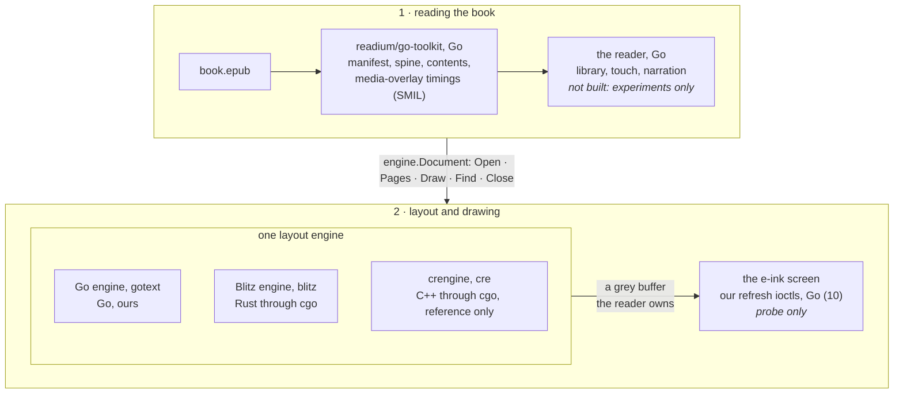
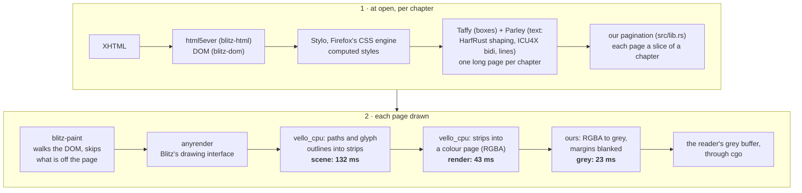
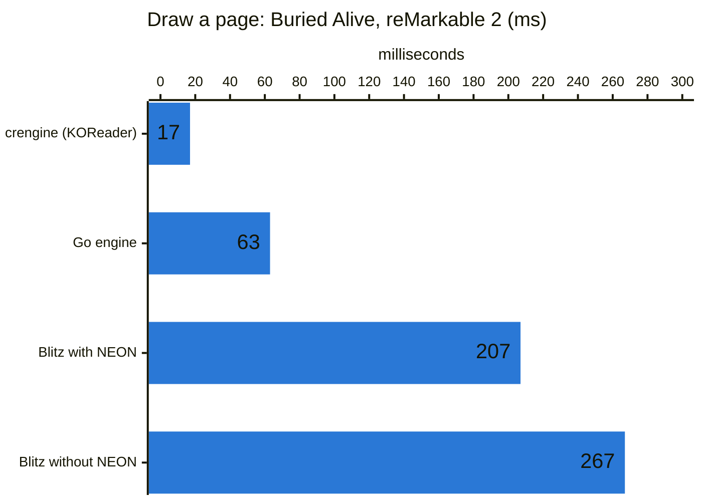
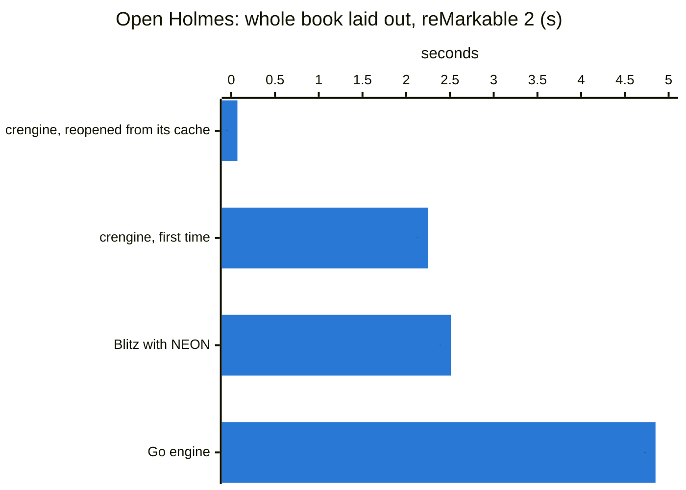
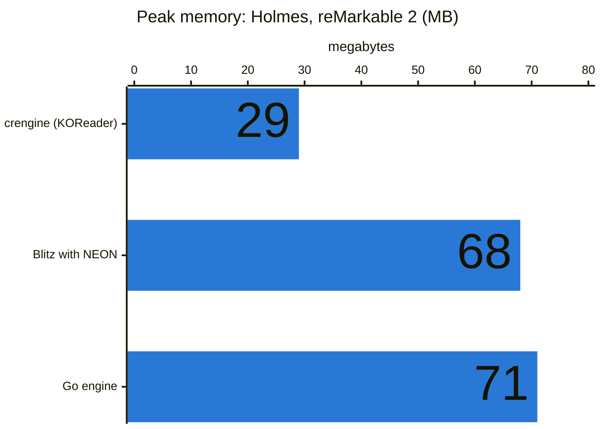
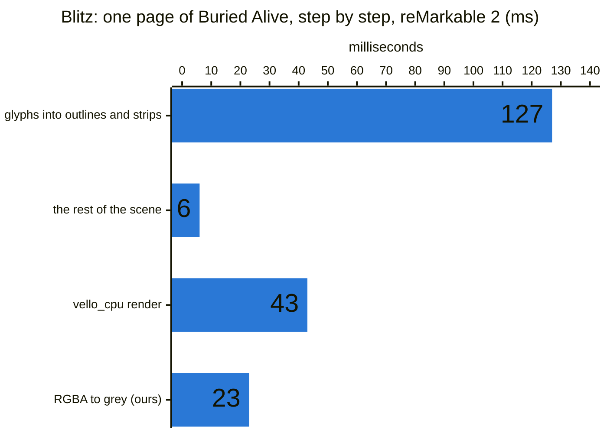
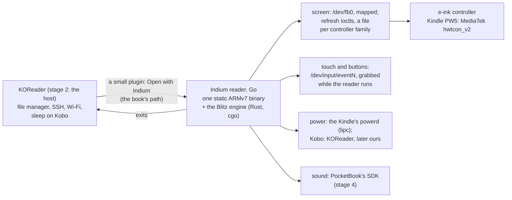

# Indium's components, and where a page's time goes (2026-10-23; the device side 2026-10-25)

A map of the parts, for finding your way around: what each one is, how a page flows through each engine, what the
device measurements say about each step, which layer every speed-up lives in, what the reader leans on on a device,
and what it all depends on (sections 6 and 7). Why the engine interface keeps state (and the outside design
discussion it was checked against) is in `engine-design.md`; the stages ahead are in `roadmap.md`; the numbers come
from the experiments' NOTES.md files, mostly 06 (the reMarkable 2) and 09–10 (the Kindle).

## 1. The reader, top to bottom



| Part | What it is | Language, licence | In the repo | State |
|---|---|---|---|---|
| readium/go-toolkit | Readium's EPUB reader library | Go, BSD | used by `experiments/engine/epub` (trimmed: 02's `trim-gotoolkit.sh`) | works |
| `engine.Document` | the seam between reader and engine | Go | `experiments/engine/engine.go` | works; hit-testing not yet |
| Go engine, "gotext" | our layout on go-text, rtlbook's CSS subset | Go, ours | `experiments/03-own-layout/layout` | works |
| Blitz engine, "blitz" | Blitz's CSS and layout, our pagination | Rust (cgo), MIT/Apache | `experiments/04-rust-engine/blitz-engine` | works |
| crengine, "cre" | KOReader's engine | C++ (cgo), GPL-2.0 | `experiments/02-crengine-go` | the reference only |
| read-along test | words highlighted from the SMIL timings | Go | `experiments/engine/cmd/readalong` | passes on all three |
| screen refresh | the page into `/dev/fb0`, one ioctl per refresh | Go, ours | `experiments/10-refresh/probe` | works on the Kindle (10) |
| on a device | KOReader, input, power, sound: section 6 | | | |

## 2. Inside each engine

Every engine does the same four jobs. They differ in who does each one and in what the drawing ends in.


**Go engine (03):** all ours except the shaper, all Go, one static binary.
```
  XHTML ─ layout/book.go ─▶ blocks ─ layout/css.go (small cascade) ─▶ styles
        ─ layout/text.go: go-text (a HarfBuzz port) shapes, bidi, lines, justification
        ─ layout/page.go: pages (orphans, widows, headings kept with what follows)
  draw: glyphs drawn once and cached between pages (raster/), straight into grey
```

**Blitz engine (04):** Blitz does everything up to one long laid-out document; we cut it into pages and convert the
drawing to grey. Go reaches it through cgo (`src/capi.rs`, `blitz_engine.h`), and it asks Go for the book's files
through a callback.


**crengine (KOReader, 02):** one C++ engine with its own HTML, CSS and pagination, FreeType and HarfBuzz for glyphs.
It keeps each glyph once drawn, draws straight into grey, and saves a laid-out book to disk so it reopens at once.
GPL-2.0 and cgo (a C toolchain per device's firmware) keep it out; it is the bar to measure against.

## 3. What the device says (reMarkable 2: Cortex-A7, 1.2 GHz, 1 GB)

| | crengine (KOReader) | Go engine | Blitz (NEON) |
|---|---|---|---|
| draw a page: *Buried Alive*, Holmes | **17, 19 ms** | 63, 103 ms | 207, 257 ms |
| open, first time | **0.5, 2.2 s** | 1.5, 4.9 s | 0.7, 2.5 s |
| reopen | **57, 68 ms** (its cache) | as first time | as first time |
| peak memory | **18, 29 MB** | 34, 71 MB | 39, 68 MB |







What the numbers mean for reading:
- **A page turn** is the drawing plus the screen's own refresh, about 200–500 ms. crengine and the Go engine hide
  behind the refresh; so does Blitz since experiment 07 (20 ms a page, below); before, it added as much again.
- **Opening a book** waits for the layout. Seconds are too long; crengine's answer is its disk cache.
- **Read-along** does not redraw the page per word: the highlight is a box inverted on the page already drawn, so it
  does not depend on drawing speed.

Blitz's ~200 ms, one page of *Buried Alive* (06, `run-scene.sh`), before experiment 07 took it to 20 ms:

The glyphs are redone for every glyph on every page; 34 ms of the render is the same for a blank page.
Hinting costs nothing (the same 132 ms without it).

## 4. The levers for Blitz, and whose code each is in

| Lever | Layer | Whose code | Gain | State |
|---|---|---|---|---|
| Skip the lines off the page | blitz-paint | a patch to Blitz (`blitz-cull-lines.patch`) | Mac 4.7 → 3.6 ms | done |
| Grey from one channel | our `Book::draw` | ours | Mac 1.3 ms | done |
| NEON on | the build | a flag (`engine/build-armv7.sh`) | device −23% | done |
| Keep one renderer between pages | our `Book::draw` | ours | Mac 3.7 → 3.5 ms | done (07) |
| Switch vello_cpu's glyph cache on (off by default; anyrender never turns it on) | anyrender_vello_cpu | a one-line patch | none: render time up as much as scene time down, and a 64 MB atlas | dropped (07) |
| No white background: transparent, white added while converting | our `Book::draw` | ours | Mac 3.5 → 3.3 ms | done (07) |
| **Our glyph layer:** glyphs drawn once into masks and copied straight onto the grey page; vello_cpu only for what is not text, only on pages that have any | ours (`blitz-engine/src/glyphs.rs`) | ours | **device 206–258 → 20 ms**, crengine's speed | done (07) |
| Lay out the chapter being opened first, the rest after | our `Book` (`layout`, `layout_rest`) | ours | first page 3–10× sooner, half the memory | done (08) |
| Pictures decoded when drawn, at the size drawn (only their size read for layout) | Blitz's image loading; our `pictures.rs` | a patch to Blitz (`blitz-lazy-images.patch`) and ours | Haji Agha: open at a scan 116–250 → 64–104 ms, 171 → 40 MB | done (08) |
| Chapters let go: only the two the reader used last stay laid out | our `Book` (`Options::keep`) | ours | memory read through: Holmes 71 → 41 MB, Haji Agha 89 → 60 MB | done (08) |
| Page counts and positions kept on disk, as crengine's cache | our `Book` | ours | reopening | to try (08) |

Drawing is done (experiment 07's NOTES.md): 20 ms a page on the reMarkable 2, against crengine's 17–19 ms. What is
left against crengine is opening (0.7–2.5 s, crengine 57–68 ms from its cache) and memory (2× crengine's).

## 5. What we carry on top of others' code

| Patch | On | Why | Where |
|---|---|---|---|
| line culling | Blitz at 21edc92 | its painter drew every line of a paragraph crossing the page's edge | `experiments/04-rust-engine/blitz-cull-lines.patch` |
| pictures left undecoded | Blitz at 21edc92 | it decoded every picture at full size while loading and kept it (a scan: 76 MB); now only the size, the file kept for our `pictures.rs` to decode when drawn | `experiments/04-rust-engine/blitz-lazy-images.patch` |
| measuring switches | Blitz | `BLITZ_NO_HINT`, `BLITZ_NO_GLYPHS`, for one profiling build only | `experiments/06-device-timing/blitz-knobs.patch` |
| justification fix | go-text | one line; lines ended a gap short | experiment 01 (to report upstream) |
| trim | readium/go-toolkit | drops the AWS and Google Cloud SDKs (+27 MB binary, +26 MB memory) | `experiments/02-crengine-go/trim-gotoolkit.sh` (to propose upstream) |

## 6. On the device

What the reader stands on once it runs on an e-ink device, as the roadmap's stage 2 has it (a reader KOReader's file
manager opens a book with). The Kindle Paperwhite 11th gen is the device the screen parts were tried on (09, 10).



| Part | What it does | Whose | State |
|---|---|---|---|
| KOReader | stage 2's host: its file manager starts the reader; it keeps SSH, Wi-Fi and (on Kobo) sleep | KOReader, AGPL-3 | installed on the Kindle (v2026.07.1); the plugin not written |
| the plugin | "Open with Indium" in KOReader's file manager; runs the reader, redraws KOReader's screen after | ours, Lua inside KOReader | not written (stage 2) |
| screen refresh | the page into the framebuffer, refreshed with a waveform: REAGL page turns, A2 for the read-along mark (10) | ours, Go | the Kindle's MediaTek driver done (10); Kindle and Kobo NXP, Kobo MediaTek, PocketBook later |
| input | touches and page buttons as Linux input events, the touch device grabbed (`EVIOCGRAB`) so KOReader does not see them | ours, Go | not written (stage 2); on the Kindle the touch is `pt_mt` (`event1`), the power key `event0` |
| power | the Kindle's `powerd` sleeps on its own; held off with `lipc-set-prop com.lab126.powerd preventScreenSaver` (09, 10) | Amazon's firmware | used by the experiments' scripts |
| sound | narration's audio | PocketBook's SDK (Kindle and Kobo: closed to us) | stage 4; a PocketBook needed |
| launcher | KUAL (Kindle), NickelMenu (Kobo), a PocketBook app | others' | stage 5 only |
| `fbink` | KOReader's build of FBInk: refreshes by hand while trying things | FBInk, GPL-3 (to confirm) | experiments 09–10 only; not in the reader |

## 7. What Indium depends on, and the licences

The reader is to be one static binary: what is linked into it is what its licence has to live with. Rust crates
counted from `cargo metadata` of `blitz-engine` for the ARMv7 target (2026-10-25): 215 crates, none GPL; the only
copyleft is MPL-2.0 (file by file: a changed file of theirs has to be published; we change none).

| Dependency | For | Licence | In the reader |
|---|---|---|---|
| readium/go-toolkit | EPUB, positions, SMIL timings | BSD-3 | yes (trimmed, 02) |
| Blitz: blitz-dom, blitz-html, blitz-paint | HTML, CSS, layout, painting | MIT / Apache-2.0 | yes, with our two patches (section 5) |
| Stylo, cssparser, selectors, and small crates with them (app_units, dtoa-short, to_shmem, uluru) | Firefox's CSS engine, inside Blitz | **MPL-2.0** (14 crates) | yes, unchanged |
| Parley, fontique, HarfRust, skrifa | text: fonts, shaping, lines | MIT / Apache-2.0 | yes |
| Taffy | boxes (flex, grid, block) | MIT | yes |
| vello_cpu, anyrender | drawing what is not text | MIT / Apache-2.0 | yes |
| html5ever | parsing XHTML | MIT / Apache-2.0 | yes |
| ICU4X | bidi, line breaking, Unicode data | Unicode-3.0 (22 crates) | yes |
| image, png, zune-jpeg, jpeg-decoder | pictures | MIT / Apache-2.0 (/ Zlib) | yes |
| rayon | both cores | MIT / Apache-2.0 | yes |
| Linux's framebuffer, mxcfb/MediaTek and input interfaces | screen and touch | the kernel's interface (numbers and struct layouts, no code) | called |
| go-text | the Go engine | BSD-3 / Unlicense | only if the Go engine stays (the reference) |
| KOReader | stage 2's host | AGPL-3 | no: a separate program. Its framebuffer code (`ffi/framebuffer_mxcfb.lua`, `mxcfb_kindle_h.lua`) read as a reference, nothing copied. The plugin runs inside it: its licence to check |
| FBInk (`fbink`) | trying refreshes by hand | GPL-3 (to confirm) | no |
| crengine | the bar to measure against | GPL-2.0 | no |
| the Kindle's `powerd`, `lipc` | sleep held off | Amazon's | no: run as commands |
| Go, Rust (musl, static), zig (cgo cross-builds), Docker images `eink-go`, `eink-rust`, `eink-cre`, `eink-koreader` | building and measuring | — | build tools |

## 8. Words used here
- **Scene:** the list of drawing commands for a page (fill this shape, draw these glyphs), built before anything is drawn.
- **Outline, strips:** a glyph is stored as curves (its outline); vello_cpu cuts outlines into strips of pixel
  coverage, which rendering then paints.
- **Glyph cache (atlas):** each glyph drawn once at a size into a small image, then copied wherever it appears.
- **Hinting:** nudging a glyph's outline onto the pixel grid for sharper small text.
- **Render, rasterise:** turning the scene into pixels.
- **RGBA, premultiplied:** four bytes a pixel, colour already multiplied by opacity; on white, a pixel shows
  `colour + (255 − opacity)`.
- **NEON:** ARM's instructions working on several numbers at once; every chip we target has them; Rust's 32-bit ARM
  target leaves them off unless asked.
- **cgo:** Go calling C (and so Rust or C++ behind a C interface); it brings a C toolchain into the build.
- **Static binary:** one file with everything inside, so it runs on any ARM Linux with nothing installed.
- **SMIL, media overlay:** an EPUB's timings of recorded narration, word by word; what read-along plays.
- **Inline root, line box:** in Blitz, an element holding text and its lines, which our pagination cuts between.
