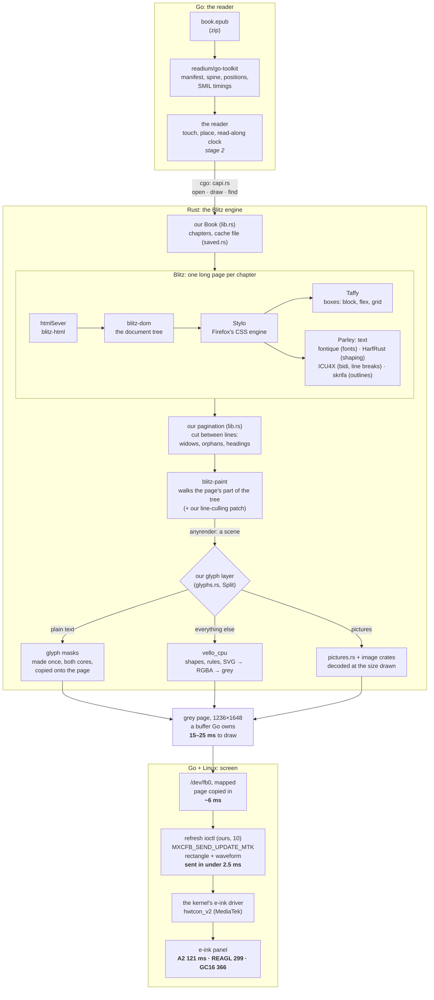
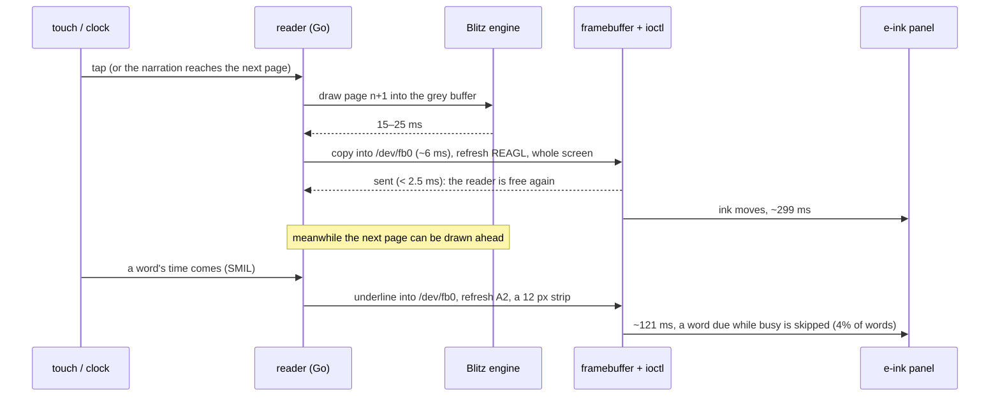
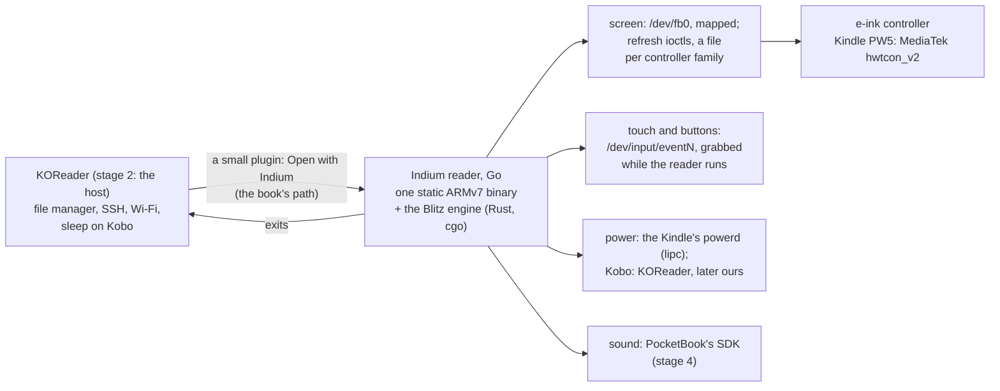

# Indium's design: the parts, from the book to the ink (2026-10-25)

What each part is, how a page goes from an EPUB file to ink on the screen, what the reader stands on on a device, where
we stand against crengine, and what it all depends on. The stages ahead are in `roadmap.md`; the details and every
measurement in the experiments' NOTES.md files (the numbers here: 08 on the reMarkable 2, 09–10 on the Kindle).

## 1. The layers

- **Go runs the reader:** readium/go-toolkit reads the book (zip, manifest, spine, table of contents, positions, the
  media overlays' timings); Go owns the screen (the framebuffer and its refreshes), touch, the reader's state.
- **The layout engine sits behind one narrow interface,** so it can be swapped and judged: Blitz (Rust, through cgo)
  is the one we use; our Go engine on go-text (03) is the reference for rtlbook's books; crengine (02, KOReader's) is
  the bar to measure against, never shipped (GPL-2.0).
- **The engine draws into a buffer Go owns,** a byte of grey a pixel, so a page is not copied across the boundary.

**The interface keeps state; it is not one call per page.** Page 40 depends on everything laid out before it,
read-along asks which page and boxes hold a word's id, Readium positions ask the reverse, and a tap asks what is under
a finger. So a book is opened once and kept behind a handle:

```
open(book source, page size, settings)    lay out (the chapter shown first, the rest after), or restore from cache
page count
draw page n into a buffer Go owns
page and boxes of an element id           read-along
id at a point                             taps, selection (not built yet)
```

In Go: `experiments/engine` (`engine.Document`: `Pages`, `Draw`, `Find`, `Close`; engines by name: "gotext", "cre"
with `-tags cre`, "blitz" with `-tags blitz`). Across cgo (`blitz-engine/src/capi.rs`, `blitz_engine.h`) Go passes
its buffers in, strings as pointer and length, and answers the engine's file requests through a callback, so
go-toolkit stays in charge of the EPUB. Not yet through it: 08's chapter-first opening and the cache (stage 0–2).

## 2. From the book to the ink

Every part a page goes through, whose it is, and its time on the Kindle (two Cortex-A53 cores, *Buried Alive* and
Holmes).



| Step | Part | Whose | Notes |
|---|---|---|---|
| Read the book | readium/go-toolkit | Readium, BSD | trimmed of its cloud SDKs (02's `trim-gotoolkit.sh`) |
| Parse | html5ever, blitz-html, blitz-dom | Servo's parser; Blitz | XHTML into a tree |
| Style | Stylo | Firefox's CSS engine (MPL-2.0) | the books' real CSS; why Blitz matches Chromium on 383 of 388 pages (05) |
| Boxes | Taffy | Dioxus Labs | block, flex, grid; not text |
| Text | Parley, with fontique, HarfRust, skrifa, ICU4X | Linebender; HarfRust: HarfBuzz's; ICU4X: Unicode | fonts, shaping (Farsi joined right), bidi, line breaking; Blitz's text layouts on both cores (`parallel-construct`) |
| Pages | `lib.rs` | ours | Blitz has no pagination: we cut its long page between line boxes, 03's rules |
| Keep | `saved.rs` | ours | a cache file per book (pages, glyph masks): a reopen lays out only the chapter shown |
| Paint | blitz-paint, anyrender | Blitz | a scene of drawing commands for the page; our patch skips lines off the page |
| Glyphs | `glyphs.rs` | ours | each glyph drawn once into a mask (by vello_cpu), then copied: 266 → 20 ms a page (07) |
| The rest | vello_cpu | Linebender | shapes and SVG; runs only on pages that have any |
| Pictures | `pictures.rs`, image, zune-jpeg, png | ours; image-rs | only their size read for layout (our Blitz patch); decoded when drawn, at that size |
| Screen | `/dev/fb0` mapped; one ioctl a refresh | ours, Go (10) | a file per controller family; Kindle MediaTek done |
| Ink | the kernel's driver and the panel | Amazon, E Ink | the waveform decides time and look |

### A page turn and a narrated word, in time



## 3. The engines

| Engine | What it is | Use |
|---|---|---|
| **Blitz** ("blitz") | Blitz's CSS and layout, our pagination, glyph layer, pictures and cache | the engine (decided 2026-10-25): real CSS, Farsi right, crengine's speed |
| Go engine ("gotext") | our layout on go-text, rtlbook's CSS subset | the reference on rtlbook's books (94–100% of Chromium's line starts) |
| crengine ("cre") | KOReader's engine, C++, its own HTML, CSS, pagination | the bar to measure against; GPL-2.0, never shipped |

Any engine is judged the same way: 03's `compare.sh` (every word in a span, then each engine and Chromium say where it
went), the read-along test (`experiments/engine/cmd/readalong`), times and memory on a device.

## 4. On the device

What the reader stands on once it runs on an e-ink device, as the roadmap's stage 2 has it (a reader KOReader's file
manager opens a book with). The Kindle Paperwhite 11th gen is the device the screen parts were tried on (09, 10).



| Part | What it does | Whose | State |
|---|---|---|---|
| KOReader | stage 2's host: its file manager starts the reader; it keeps SSH, Wi-Fi and (on Kobo) sleep | KOReader, AGPL-3 | installed on the Kindle (v2026.07.1); the plugin not written |
| the plugin | "Open with Indium" in KOReader's file manager; runs the reader, redraws KOReader's screen after | ours, Lua inside KOReader | not written (stage 2) |
| screen refresh | the page into the framebuffer, refreshed with a waveform: REAGL page turns, A2 for the read-along mark (10) | ours, Go | the Kindle's MediaTek driver done (10); Kindle and Kobo NXP, Kobo MediaTek, PocketBook later |
| input | touches and page buttons as Linux input events, the touch device grabbed (`EVIOCGRAB`) so KOReader does not see them | ours, Go | not written (stage 2); on the Kindle the touch is `pt_mt` (`event1`), the power key `event0` |
| power | the Kindle's `powerd` sleeps on its own; held off with `lipc-set-prop com.lab126.powerd preventScreenSaver` (09, 10) | Amazon's firmware | used by the experiments' scripts |
| sound | narration's audio | PocketBook's SDK (Kindle and Kobo: closed to us) | stage 4; a PocketBook needed |
| launcher | KUAL (Kindle), NickelMenu (Kobo), a PocketBook app | others' | stage 5 only |
| `fbink` | KOReader's build of FBInk: refreshes by hand while trying things | FBInk, GPL-3 (to confirm) | experiments 09–10 only; not in the reader |

**Waveforms** (10, by eye): page turns REAGL without a flash (they look alike in day mode; a flash shows most in night
mode), a flash now and then (how often: in use); the read-along mark A2, an underline that never touches the
letters. Night mode driven by us is not tried yet.

## 5. Where we stand against crengine

Blitz built with NEON and `parallel` (both cores); crengine as KOReader runs it on the same device.

| | reMarkable 2 (08) | | Kindle PW 11th gen (09) | |
|---|---|---|---|---|
| | **Blitz** | crengine | **Blitz** | crengine |
| draw a page | 13–20 ms | 16–19 | 15–25 ms | 19–24 |
| open a book, first time | 0.12–0.28 s | 0.47–2.25 | 0.28–0.43 s | 0.54–2.55 |
| reopen (from the cache) | 50–57 ms (Haji Agha); 128–241 ms (long chapters) | 57–85 | 0.17–0.38 s (`/mnt/us` is slow FUSE) | 0.09–0.14 |
| memory, reading through | 22 / 43 / 56 MB | 18 / 29 / 20 | | |
| a scan's first draw | 1.1–1.5 s | ~0.3 | | |

Left against crengine: a reopen's own chapter layout (Blitz cannot keep it on disk), memory (1.2–2.8×), scans
(jpeg-decoder has no SIMD on ARM), Holmes's SVG title page (284 ms) and one long first page (65 ms). How each speed-up
was found and measured: 06, 07 and 08's NOTES.md.

## 6. What we carry on top of others' code

| Patch | On | Why | Where |
|---|---|---|---|
| line culling | Blitz at 21edc92 | its painter drew every line of a paragraph crossing the page's edge | `experiments/04-rust-engine/blitz-cull-lines.patch` |
| pictures left undecoded | Blitz at 21edc92 | it decoded every picture at full size while loading and kept it (a scan: 76 MB); now only the size, the file kept for our `pictures.rs` to decode when drawn | `experiments/04-rust-engine/blitz-lazy-images.patch` |
| measuring switches | Blitz | `BLITZ_NO_HINT`, `BLITZ_NO_GLYPHS`, for one profiling build only | `experiments/06-device-timing/blitz-knobs.patch` |
| justification fix | go-text | one line; lines ended a gap short | experiment 01 (to report upstream) |
| trim | readium/go-toolkit | drops the AWS and Google Cloud SDKs (+27 MB binary, +26 MB memory) | `experiments/02-crengine-go/trim-gotoolkit.sh` (to propose upstream) |

## 7. What Indium depends on, and the licences

The reader is to be one static binary: what is linked into it is what its licence has to live with. Rust crates
counted from `cargo metadata` of `blitz-engine` for the ARMv7 target (2026-10-25): 215 crates, none GPL; the only
copyleft is MPL-2.0 (file by file: a changed file of theirs has to be published; we change none).

| Dependency | For | Licence | In the reader |
|---|---|---|---|
| readium/go-toolkit | EPUB, positions, SMIL timings | BSD-3 | yes (trimmed, 02) |
| Blitz: blitz-dom, blitz-html, blitz-paint | HTML, CSS, layout, painting | MIT / Apache-2.0 | yes, with our two patches (section 6) |
| Stylo, cssparser, selectors, and small crates with them (app_units, dtoa-short, to_shmem, uluru) | Firefox's CSS engine, inside Blitz | **MPL-2.0** (14 crates) | yes, unchanged |
| Parley, fontique, HarfRust, skrifa | text: fonts, shaping, lines | MIT / Apache-2.0 | yes |
| Taffy | boxes (flex, grid, block) | MIT | yes |
| vello_cpu, anyrender | drawing what is not text | MIT / Apache-2.0 | yes |
| html5ever | parsing XHTML | MIT / Apache-2.0 | yes |
| ICU4X | bidi, line breaking, Unicode data | Unicode-3.0 (22 crates) | yes |
| image, png, zune-jpeg, jpeg-decoder | pictures | MIT / Apache-2.0 (/ Zlib) | yes |
| rayon | both cores | MIT / Apache-2.0 | yes |
| Linux's framebuffer, mxcfb/MediaTek and input interfaces | screen and touch | the kernel's interface (numbers and struct layouts, no code) | called |
| go-text | the Go engine | BSD-3 / Unlicense | only if the Go engine stays (the reference) |
| KOReader | stage 2's host | AGPL-3 | no: a separate program. Its framebuffer code (`ffi/framebuffer_mxcfb.lua`, `mxcfb_kindle_h.lua`) read as a reference, nothing copied. The plugin runs inside it: its licence to check |
| FBInk (`fbink`) | trying refreshes by hand | GPL-3 (to confirm) | no |
| crengine | the bar to measure against | GPL-2.0 | no |
| the Kindle's `powerd`, `lipc` | sleep held off | Amazon's | no: run as commands |
| Go, Rust (musl, static), zig (cgo cross-builds), Docker images `eink-go`, `eink-rust`, `eink-cre`, `eink-koreader` | building and measuring | — | build tools |

## 8. Words used here
- **Scene:** the list of drawing commands for a page (fill this shape, draw these glyphs), built before anything is drawn.
- **Glyph mask:** a glyph drawn once at a size into a small grey image, then copied wherever it appears.
- **Outline, strips:** a glyph is stored as curves (its outline); vello_cpu cuts outlines into strips of pixel
  coverage, which rendering then paints.
- **Inline root, line box:** in Blitz, an element holding text and its lines, which our pagination cuts between.
- **Framebuffer:** the screen's memory, `/dev/fb0`; writing it changes nothing on e-ink until a refresh is sent.
- **Refresh, waveform:** the controller told to move the ink in a rectangle, and how: A2 (black and white, fastest),
  DU, GL16 and REAGL (keep the greys, no flash), GC16 (full greys, the most thorough). A **flash** turns the area
  black and back to clear what earlier pages left (ghosting).
- **Marker:** the number a refresh is sent with; waiting on it tells when that refresh's ink has stopped.
- **NEON:** ARM's instructions working on several numbers at once; every chip we target has them; Rust's 32-bit ARM
  target leaves them off unless asked.
- **cgo:** Go calling C (and so Rust or C++ behind a C interface); it brings a C toolchain into the build.
- **Static binary:** one file with everything inside, so it runs on any ARM Linux with nothing installed.
- **SMIL, media overlay:** an EPUB's timings of recorded narration, word by word; what read-along plays.
